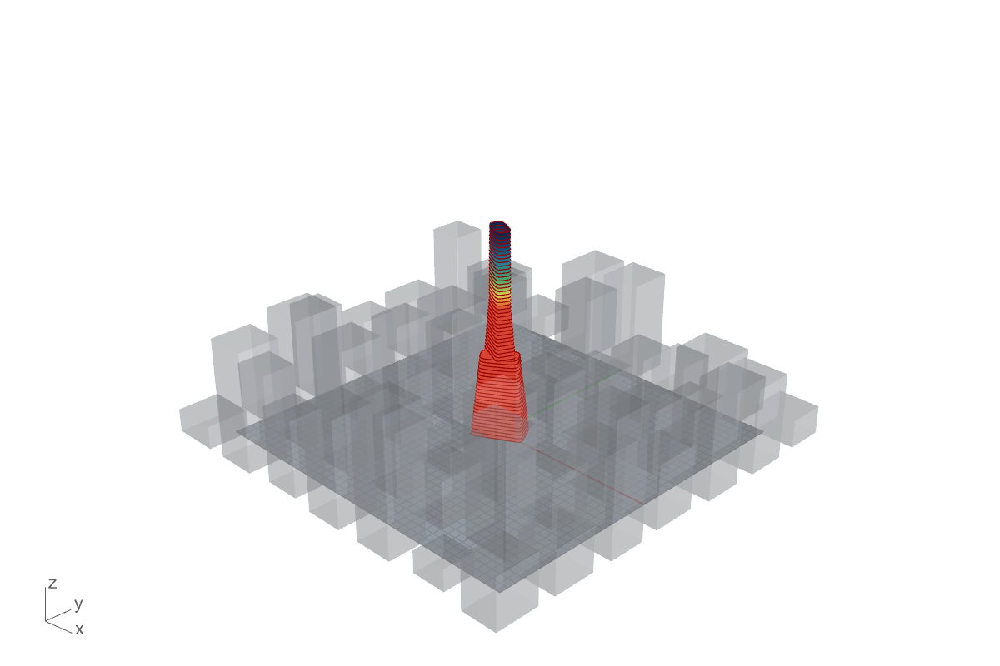

# Swalloop

*French: Hironboucle (hirondelle + boucle). German: Schwalbenschleife (Schwalbe + Schleife).*

> **swalloop_erst** is the standalone prototype (this repo), used to explore the loop semantics and the release workflow. The Grasshopper plugin that follows will be called **Swalloop**.

A node-based loop editor for form-finding, in the spirit of Anemone. The name and look come from the swallow: it leaves, travels, and returns to the same nest, the way a loop feeds its result back to its start. **Loop Start** is *Take off*, **Loop End** is *Return*, and the loop nodes live in the *Migration* category. The palette is the swallow's own: midnight-blue back, cream belly, rust throat. The test subject is a skyscraper in a Manhattan- or Dubai-like neighbourhood; the loop reshapes it under wind, structure and sun.

## Run

```bash
npm install
npm run app:dev   # desktop window with hot reload
npm run app       # build, then open the desktop app
npm run dev       # browser only (no FreeCAD export)
```

## Templates and files

The app opens on a start screen: **Open the skyscraper form-finding template** (the tower case), a variant (Dubai, or the tuned settings), **Blank canvas**, **Open file...**, and the loop basics (numbers only, no tower). Nothing is hard-wired: the tower case is a template file like any other, marked `featured`.

A canvas is one JSON file, `*.swalloop.json`. The templates live in [`templates/`](templates), a pack lists which files it owns, and **Save file** / **Open file...** in the palette read and write the same format. Files record the wiring and every parameter, never the editor's drawing details, so another host can read them (the plan is a Grasshopper plugin). The format is specified in [docs/graph-format.md](docs/graph-format.md).

## Analysis nodes

A general-purpose pack for the maths that spatial design keeps reaching for. None of it knows about towers: three adapters in the skyscraper pack (**Floor profile**, **Floor outline**, **Context splats**) turn a tower or a context into the plain lists, point lists and splats these nodes take.

| Node | What it does, and a real use |
|---|---|
| **Integrate** | Trapezoid or Simpson over y(x); *x·f* gives the first moment. Base shear and overturning moment from a wind load profile (matches the tower's own sums to about 3 percent, which is the half floor each end). |
| **Log wind profile** | The logarithmic wind law for a roughness length z0, and the power-law exponent that fits it. z0 0.03 gives 0.14, 1 m gives 0.28, in line with textbook values. Wire the exponent into the Wind node. |
| **Fourier smooth** | Low-pass a profile with a DFT, *Mirror* ends so there is no wrap-around. Four harmonics describe a tower's whole width taper. |
| **Fourier outline** | Fourier descriptors of a closed outline (x + iy as one complex sequence): fewer harmonics, a simpler outline, with the deviation and the area it kept. |
| **Gaussian splat field** | 2D Gaussian splats onto a grid. *Additive* is a density or shelter map; *Composite* blends front to back by depth with the same rule as 3D Gaussian splatting (C += T·a·v, T *= 1 − a). This is the splat-and-blend core in 2D, not a 3D trainer. |
| **Affine matrix**, **Matrix product**, **Matrix power**, **Apply matrix** | Homogeneous 3x3 transforms. Floor i of a twisting, tapering tower is the base outline times M to the power i. |
| **Polygon**, **Principal axes** | A base outline, and the main axis and elongation of any point set from its covariance. |
| **List math**, **Collect** | Element-wise arithmetic on lists, and gathering lists so one view can compare them. |

Five templates show them (group *Analysis and vision* on the start screen): **Log wind profile**, **Tower in log-law wind** (the exponent comes from the roughness, not from a typed number), **Fourier: simplify the loft**, **Gaussian splats: shelter map**, **Matrix powers: twisting tower**. Their results appear as a heatmap, a multi-line plot or an outline plot in the Inspector.

`npm run test:analysis` checks the maths against closed-form answers (Simpson is exact for x squared, an ellipse is exactly one Fourier harmonic, R(10 deg) to the ninth is R(90 deg), a rectangle's principal axes). `scripts/make-analysis-templates.mjs` writes the five template files and refuses any that does not load and evaluate.

## The C# port (for Grasshopper)

[`dotnet/`](dotnet) holds `Swalloop.Core`, the same engine and the same node logic in C# (netstandard2.0, no NuGet dependencies, so one assembly loads in Rhino 8 on .NET Framework and on .NET 8). It reads the same `*.swalloop.json` files. The JavaScript engine stays the reference: `npm run test:parity` regenerates its results for every template (`dotnet/golden/`) and the C# tests must reproduce them (all numbers agree to better than 1e-10).

```bash
npm run test:parity   # JS results -> golden files -> C# comparison, plus the file-format and engine rules
npm run test:dotnet   # only the C# side, against the golden files already on disk
```

When you change node logic in JavaScript, run `npm run test:parity`; a C# failure means the port has to follow.

### The Grasshopper plugin

[`dotnet/Swalloop.Grasshopper`](dotnet/Swalloop.Grasshopper) turns that core into a `.gha`. The first component, **Swalloop Template**, runs any template file inside Grasshopper: the loops iterate internally, so a 150-pass tower is one solve, and it returns the floor curves, the metrics and the pass count.

```bash
npm run gha:install   # build and copy Swalloop.gha to %APPDATA%GrasshopperLibraries (close Rhino first)
npm run gha:verify    # start Rhino 8, solve every tower template in Grasshopper, compare with the golden files
```

`gha:verify` has been run on Rhino 8.27: all four tower templates give the same floors, metrics and pass counts as the desktop app (to about 1e-16).

Beyond that one component there is **one Grasshopper component per node type** (generated from the same registry as the editor), a **Loop Start / Loop End** pair that runs the engine on the wired body, and every template as a real `.gh` canvas in [`templates/grasshopper/`](templates/grasshopper). `npm run gha:canvases` builds each template as a canvas inside Rhino, compares **every node's outputs** with the golden files, then reopens the saved `.gh` files from disk and compares again (15 of 15 match). See [dotnet/Swalloop.Grasshopper](dotnet/Swalloop.Grasshopper/README.md).

Grasshopper gets the same opening as the desktop app: a **Swalloop** menu in the menu bar with *Open the skyscraper form-finding template* at the top and every template below it, grouped as on the start screen. The templates travel inside the plugin, so it needs no files on disk. `npm run gha:menu` clicks it like a user and checks the opened canvas against the golden file.



## How the loop works

The canvas is a DAG: a wire that would feed a result back into its own inputs is refused, like Grasshopper. **Loop Start** and **Loop End** are the deliberate loophole. Loop End re-evaluates everything between the two nodes up to *Max iter.* times, feeding its result back into Loop Start through memory. It stops early when the largest change (in the data type's own units, metres for a tower) is below *Tolerance*.

Loop End pairs with the nearest unclaimed Loop Start upstream (inner loops first, so nesting works). Its `History` output is a record `{ frames, count, max }` with every iteration; the viewers replay it.

## The tower model

The tower is a loft through one closed curve per floor (a superellipse: `w`, `d`, `rot`, `round`).

| Node | Does |
|---|---|
| Wind | Wind load per floor (height profile, drag from shape, shelter from taller upwind neighbours) |
| Orient | Per floor: searches rotations, scoring wind load against sun-facing; adapts aspect and roundness |
| Structure | Sizes each plate for axial load + wind overturning (`(N + 6M/d) / (share x allowable)`) |
| Sun | Per-floor sun exposure, shaded by the context |
| Metrics | Floor area, structure volume, base moment, max utilisation |

These are first-order engineering approximations for design exploration, not a code-compliant analysis.

### Limits on Orient

Orient carries hard limits that the optimiser can never break (Structure re-applies the size limits after it resizes a plate). Sizes and twist use 0 for "off".

| Parameter | Meaning |
|---|---|
| Min width / Min depth (m) | Smallest bounding-box sides of any floor |
| Min corner radius (m) | Radius is taken as roundness x half of the shorter side |
| Max rotation / pass (deg) | How far a floor may turn in one pass (90 = no limit) |
| Max twist from base (deg) | No floor may be turned further than this from floor 0 |
| Floor-to-floor smoothing | 0..1, relaxes rotation, width, depth and roundness toward their neighbours |
| Search | *Grid* (default) or *Refined*, which places the best rotation between grid points so a smoothed loop can settle |

### Adopt a result

The loop never rewrites the Tower sliders (that would make every re-evaluation drift). Instead, **Loop End** has two buttons:

- **Adopt result** stores the optimised floors, per floor, on the node that feeds Loop Start and switches its **Source** to *Adopted*. Switch Source back to *Initial* to get the sliders again. A run from an adopted tower continues from the result.
- **Adopt as new** copies that node and gives the copy the result, so the original stays as it was.

Any node type can opt in by defining `adopt(value)` (value to param patch); the editor and engine stay domain-free.

### Tuned examples

`Manhattan block (tuned)` and `Dubai plots (tuned)` use settings picked from a sweep over five contexts (`node scripts/optimize.mjs`): aspect 2.6, sun weight 0.35, smoothing 0.5, refined search, rate 0.4. They settle in about 40 passes. Wind moment per m2 of floor area drops roughly 30 percent (Manhattan) to 55 percent (Dubai); floor area drops by 10 to 30 percent, which is the price. Aspect is the dominant lever; rate and relaxation mostly change speed, not the result.

## Loop kinds and the Condition input

Loop End has a **Kind**:

| Kind | Does |
|---|---|
| **Repeat** | Runs up to *Max iter.* times. Stops early when the change is below *Tolerance* (0 = never), or when *Condition* is true. |
| **While** | Runs while *Condition* is true (at most *Max iter.* times). |
| **Fold** | Walks the list on *Items*, carrying the state through each element (a running total, an accumulating shape). The result is the final state; the history holds every intermediate state. |
| **For each** | Runs the body once per item, independently (no carried state, no Initial needed). The result is the list of body results. |

Loop Start gives the body `State`, `Index` and, for Fold and For each, the current `Item`. *Condition* is a boolean evaluated inside the loop at the start of every pass, on the current state, so it can read anything the body reads; build it with **Compare** (`<  <=  >  >=  ==  !=`) and **Logic** (and / or / not). **Math** and **Range** are the generic arithmetic and list nodes; numeric parameters accept a wire in place of the widget. The `Demo:` templates show each kind.

## Any data, not just towers

Loop Start and Loop End are polymorphic: their type is whatever is wired into **Initial** (the head of each loop node shows it, e.g. `Loop · number`). Wires whose types stop fitting turn red and dashed. The **Inspector** node shows what flows into it, chosen by data type: a 3D view for a tower, a value and line chart for a number, bars for a list of numbers, a tree for anything else, plus a change-per-iteration convergence curve whenever a history is connected. The `Demo:` templates (Newton's square root, the logistic map) run on the same engine with no tower involved. When several view nodes exist, a selector appears above the right-hand pane.

A pack can register a view for its own data type: `registerDataView({ name, is, Component })` in `src/core/dataViews.js`.

## Colouring the tower

The **Viewer** node decides what the spectrum shows. *Colour by* picks the criterion (utilisation, height, wind load, wind exposure, sun exposure, plate area, rotation, roundness, aspect, facade wind, facade sun). *Colormap* picks Turbo, Viridis, Inferno or Cool-warm, and *Reverse* flips it. *Range* is Auto (taken from the final tower, so colours hold still while a run replays) or Manual with your own *Min* and *Max*; those two can be wired from Number nodes. New criteria are one entry in `src/metrics.js`.

## FreeCAD export

In the desktop app, *Export to FreeCAD* runs `electron/freecad_export.py` through `FreeCADCmd` and writes `tower.FCStd`, `tower_mass.step` (smooth spline loft) and `tower.ifc` (floor slabs and neighbours) to `Documents/Swalloop/`. Set `FREECAD_CMD` if FreeCAD is not in `Program Files`.

## Layout

```
templates/           graph files: the skyscraper case and the loop basics, as data
dotnet/              C# port of the engine and nodes (Swalloop.Core), its golden-file tests, and the Grasshopper plugin
src/core/            domain-free: engine (loops, scopes, pairing), registry, graph file format, Loop / Number / Readout nodes
src/packs/math/         two demo iterations (Newton, logistic map) on the generic Inspector
src/packs/skyscraper/  the template: Tower, Wind, Orient, Structure, Sun nodes, floor curves, 3D viewer, templates
src/packs/index.js   registers the packs        src/packs/views.jsx   node type -> viewer component
src/App.jsx, NodeView.jsx   the editor (talks to the registry only)
electron/            desktop shell and the FreeCAD bridge        scripts/   headless tests and sweeps
```

The engine knows nothing about towers. A pack adds its own node types, data types and templates through `registerPack()` (see `src/core/registry.js`); a data type can supply its own `distance(a, b)` for the loop's stop condition, and anything without one is compared recursively (numbers, lists, records). `npm test` runs the core engine against a made-up maths pack to keep it that way; `npm run test:tower` checks the tower limits, Adopt and the tuned templates; `npm run test:templates` checks the file format and that every template file loads and evaluates; `npm run test:analysis` checks the analysis nodes against closed-form answers; `npm run test:all` runs all four.
